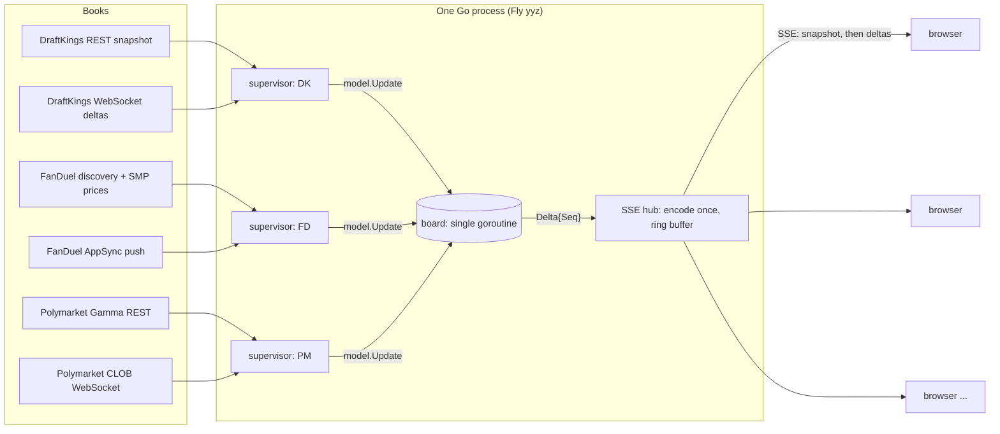

# DraftKings vs FanDuel: live NFL odds board

**Live:** https://betstamp-odds.fly.dev/ (Fly.io, Toronto `yyz`)
**Repo:** this repository. The app is in [`app/`](app/); the investigation that came before it is in [`research/`](research/).

A Go service that holds **one** live connection per sportsbook, normalizes
DraftKings, FanDuel (and, as the "third book" proof, Polymarket) into one
model, works out the best price per game / market / side, and pushes every
change to any number of browsers over Server-Sent Events. Moneyline, spread
and total, pregame and in-play, for the NFL (required) and the NBA (extra).

| Brief asks for | Where it stands |
|---|---|
| NFL pregame + live ML / spread / total from DK and FD | Done; NBA main lines and Polymarket added as extras |
| One normalized model (game, market, side, line, odds, book) | Done ([§5](#5-shape-of-the-data-and-matching)) |
| Board with best price + book name, toggle Best / DK / FD | Done, plus American/decimal toggle and NFL/NBA tabs |
| Pushes updates on its own | Done: SSE, every change sent immediately, no batching |
| Live at a public URL | https://betstamp-odds.fly.dev/ |
| Keeps working when a book is down; stale data made obvious | Done: per-book health, greyed stale cells, ⚠ on old prices, poll fallback |
| End-to-end latency per book, pregame and live | Measured per hop with error bounds ([§3](#3-speed-and-latency)); live game on Fly still to record |
| One ingestion per book; many viewers; a third book without re-architecting | Done; Polymarket added by touching only its own package plus a 3-line registration |
| Best price across different lines | Rule defined and tested ([§5.4](#54-best-price-when-books-are-on-different-lines)) |

---

## Contents

1. [Run it locally](#1-run-it-locally)
2. [Architecture](#2-architecture)
3. [Speed and latency](#3-speed-and-latency)
4. [Getting the data, book by book](#4-getting-the-data-book-by-book)
5. [Shape of the data and matching](#5-shape-of-the-data-and-matching)
6. [Auth, geo, bot protection and rate limits](#6-auth-geo-bot-protection-and-rate-limits)
7. [Backend design: one ingestion, many viewers, more books](#7-backend-design-one-ingestion-many-viewers-more-books)
8. [Staying correct when things go wrong](#8-staying-correct-when-things-go-wrong)
9. [The page](#9-the-page)
10. [Testing](#10-testing)
11. [Deployment](#11-deployment)
12. [What's next, and scaling to 10 books](#12-whats-next-and-scaling-to-10-books)
13. [Known limitations, stated plainly](#13-known-limitations-stated-plainly)
14. [Code review: what was found and what was done](#14-code-review-what-was-found-and-what-was-done)
15. [Repository layout](#15-repository-layout)

---

## 1. Run it locally

Requirements: Go 1.27 (see `app/go.mod`), or Docker. The only third-party Go
dependency is `github.com/gorilla/websocket`.

```bash
cd app
go run ./cmd/server            # http://localhost:8080
```

With Docker:

```bash
docker build -t betstamp-odds app
docker run --rm -p 8080:8080 betstamp-odds
```

The books are Ontario sites: run it from Ontario (it was built and measured
from a home Ontario IP and from Fly's Toronto region).

Endpoints:

| Path | What |
|---|---|
| `/` | the board |
| `/stream` | SSE: one `snapshot` event, then a `delta` per change, `ping` every 15 s; resumes from `Last-Event-ID` |
| `/api/board` | full board as JSON |
| `/api/ping` | server time, for the page's clock sync and round-trip time |
| `/healthz` | always 200 while serving; per-book health in the body |
| `/metrics` | Prometheus text: per-book health, latency by phase, clock, SSE counters |

Settings (all optional):

| Env / flag | Default | Purpose |
|---|---|---|
| `PORT` / `-addr` | `8080` | listen port |
| `DEBUG_ENDPOINTS=1` / `-debug` | off | adds **Drop socket** and **Take offline 45s** buttons per book, to demo recovery |
| `PM_IN_BEST=0` / `-pm-best=false` | on | keep Polymarket out of best price |
| `NTP_SERVER` / `-ntp` | `time.google.com` | clock-offset source for latency correction |
| `FD_AK` | read from FanDuel's JS | override FanDuel's public app key |
| `FD_MAIN_JS` | none | a saved FanDuel bundle to fall back on if the live fetch fails |
| `DK_USER_AGENT` | Chrome 156 UA | override the UA DraftKings' edge requires |

Other commands:

```bash
go test -race ./...                      # everything, offline (replays captured traffic)
go run ./cmd/boardctl -seconds 120       # run the books headless, print every delta + a latency summary
go run ./cmd/boardctl -seconds 120 -kill-after 40s -kill-book draftkings   # watch recovery
go run ./cmd/probe                       # one-shot: can this machine reach each book? (used to vet Fly IPs)
```

---

## 2. Architecture



Everything runs in one binary as goroutines. The layers, and the one rule
each follows:

| Layer | Package | Rule |
|---|---|---|
| **Book** | `internal/books/{draftkings,fanduel,polymarket}` | Fetch, parse, map. Nothing else: no reconnects, no backoff, no timers beyond the socket's own ping. |
| **Contract** | `internal/book` | `Snapshot()` (REST: structure + prices + a private seed), `Stream(seed, emitter)` (push until it fails), optional `Poll()` (cheap price read). |
| **Supervisor** | `internal/supervisor` | Written once for every book: snapshot, stream, heartbeat watchdog, reconnect with backoff, poll fallback, reconcile, health. |
| **Board** | `internal/board` | Single goroutine owning all state: canonical game matching, slots, best price, game status, per-book health, latency stats. Emits `Delta`s with a global, strictly increasing `Seq`. |
| **Fanout** | `internal/fanout` | One board subscription for all viewers; each delta encoded once; recent deltas kept for resume. |
| **Page** | `cmd/server/web` (embedded) | Plain JS, one `EventSource`. |

A book never sees another book, the board, or the browser. The board never
knows which books exist: a test fails the build if the words `draftkings` or
`fanduel` appear anywhere outside `internal/books/**` and `cmd/**`.

**Data flow of one price change (DraftKings):** DK publishes a JSON delta on
its WebSocket → the DK transport stamps `RecvAt` at the socket read and feeds
it to the DK state machine → the state machine emits a `model.Update`
(`Book, GameRef, Identity, Line, American, Decimal, Status, InPlay, BookTS,
RecvAt`) → the board maps `GameRef` to the canonical game, updates the slot,
recomputes best price, stamps `AppliedAt`, publishes a `Delta` → the hub
encodes it once and writes it to every connected browser → the page updates
that one game card and flashes the cell.

---

## 3. Speed and latency

> "How old is the number on the screen?"

### 3.1 What is measured

Every price that arrives over a book's **push** channel is timed across three hops:

```
book publishes ──b2s──▶ our socket read ──process──▶ board applied ──s2y──▶ the page handles it
   BookTS                  RecvAt                       AppliedAt                 server-time "now"
└────────────────────────────── book→screen (the "Latency" row on each card) ──────────────────┘
```

| Hop | Formula | Where it's shown |
|---|---|---|
| **book→server** (b2s) | `RecvAt + NTP offset − BookTS` | page (hops row), `/metrics` (raw; add `odds_clock_offset_ms`) |
| **processing** | `AppliedAt − RecvAt`, monotonic clock, µs | `/metrics`, `boardctl` |
| **server→you** (s2y) | `server-now − RecvAt` | page (hops row) |
| **book→screen** | `server-now + NTP offset − BookTS` | page, the **Latency** row: overall, then **pregame** and **live** |

- `BookTS` is the book's own publish time: DraftKings' `websocketPublishTimestamp`
  on every update, and Polymarket's `timestamp` on price changes. **FanDuel's
  frames carry no timestamp**, so FanDuel's book→server and book→screen can't be
  measured directly (its card shows "—"); see [§3.4](#34-fanduel-without-a-publish-time).
- Samples are split by the price's in-play flag into **pregame** and **live**.
- Only prices pushed over the stream and that visibly changed count. Polls and
  snapshots don't (their freshness shows as per-price age instead).
- p50 / p95 over the last 300 samples per book per phase on the page, 4,096 on the server.

### 3.2 Clocks, and how much to trust the numbers

Book→server compares two machines' clocks, so the clocks matter more than the
code. Two corrections:

1. **Server clock vs real time (NTP).** The server does an SNTP exchange with
   `time.google.com` every 60 s (best of 4, shortest round trip):
   `offset = ((t2 − t1) + (t3 − t4)) / 2`, error at most half the NTP round trip.
   The offset is a record (value, error, measured-at, valid). It's **invalid**
   if never measured or older than 2 minutes, and while it's invalid the page
   records no corrected samples and says "uncorrected: server clock unknown".
   Unknown is never treated as zero.
2. **Browser clock vs server.** The page times `/api/ping` round trips and
   assumes the server stamped its time at the midpoint (Cristian's method),
   keeping the lowest-round-trip sample of the last 30. Error is at most half
   the round trip. No latency sample is taken until this exists.

Each latency row shows its combined bound: book→screen carries
`± (server NTP error + browser clock error)`.

**Cross-check that this works:** the development PC's clock runs fast. NTP
measured it at about −480 ms. Independently, the page's ping-based estimate
against the NTP-synced Fly server put the same PC at **−478.9 ms**. Two
methods, same answer.

What the bounds can't include: whether DraftKings' and Polymarket's own clocks
are accurate (assumed NTP-synced), and what their timestamp means (DK's is when
its WebSocket layer published, not when the trader moved the line).

### 3.3 Measured

All requests from Ontario. Pregame unless stated. n = sample count.

**On Fly (Toronto), server side, 2026-10-26 ~05:17Z** (Monday 1 AM ET, a quiet pregame board; Fly's clock: +2.9 ms ± 11.5 ms vs NTP):

| Book | book→server p50 / p95 | processing p50 / p95 (Linux) | handshake* |
|---|---|---|---|
| DraftKings | **28.5 / 33.6 ms** (n=6) | 129 / 278 µs | 41 ms |
| FanDuel | not measurable | 183 / 216 µs | 55 ms |
| Polymarket | **49.3 / 139.7 ms** (n=4,096) | 99 µs / 6.9 ms | 103 ms |

\*Handshake = one app-level request and its reply at connect (DK `subscribe` →
`subscribed`, FD `connection_init` → `connection_ack`, PM `PING` → `PONG` once
subscribed): the same measure for every book. SSE encoding averaged 17 µs per delta.

**Fly → a browser at home (Ontario), the full book→screen, same morning:**

| Book | book→screen p50 / p95 | server→you p50 | bound |
|---|---|---|---|
| Polymarket | **84 / 232 ms** (n=35) | 30 ms | ±38 ms |
| FanDuel | — (no book timestamp) | 35 ms (n=2) | ±27 ms |
| DraftKings | no DK price moved in that minute | | |

Browser ↔ Fly round trip was 60 ms. Server→you is about half of that, as expected.

**During a live game** (Sunday Night Football, KC @ SEA, 2026-10-26 ~00:25Z), measured
with `boardctl` on the home PC, with one NTP correction taken at startup (good to about ±40 ms):

| Book | book→server p50 / p95 | note |
|---|---|---|
| DraftKings | **25.0 / 50.9 ms** (n=80) | mostly updates from the live game |
| Polymarket | 41.4 / 71.7 ms (n=4,096) | mixed live/pregame |

**Still to record:** a live NFL game measured on Fly with the current per-phase
method (Monday Night Football is the next one). The page's **live** rows fill in
automatically during a game.

### 3.4 FanDuel without a publish time

FanDuel's AppSync frames have no timestamp, so book→screen is unmeasurable from
the outside. What we have:

- **Push vs polling, timed in one process** (2 min, 18 live markets, FanDuel's own
  5 s SMP polling): the socket delivered the change first on **76 of 76**
  matched price changes, median lead **1,803.5 ms**, p95 **4,079.6 ms**.
  Against 1 s polling on NBA the picture was mixed (socket first on 186 of 296
  correlated runner changes, carried by 11 socket messages), so "push is always
  first" is not claimed. Push wins by not waiting for a poll.
- Server→you to a home browser: ~30–35 ms. Handshake round trip to FanDuel: 55 ms.
- FanDuel holds WebSocket **pongs** ~1 s on its side. Its ping row reads ~1,050 ms
  while its handshake is 55 ms and TCP connect is 4–9 ms. This does not delay
  price frames.

A fair estimate would compare arrival times when DK and FD move the same line
(FD's lag relative to DK, whose latency is known). That's on the next-steps list.

### 3.5 What keeps latency down, and why each choice

| Choice | Why |
|---|---|
| **Push, not polling, for prices** on all three books | Polling adds on average half its interval (2.5 s at 5 s) before you even see a change. Measured: FD's socket beat its own 5 s poll by 1.8 s median; DK's socket beat 1 s polling on 5 of 6 live changes by ~2.2 s. |
| **Deltas, not snapshots, on the hot path** | DK sends only what changed; we apply it in place. Snapshots (REST) are for structure, startup, and reconcile, never on the price path. |
| **Socket read time stamped once, at the read** | Every hop is measured from the same instant; nothing in our pipeline hides inside "book latency". |
| **Single-goroutine board, in memory** | No locks, no database, no queue between ingest and fanout. Processing is ~100–180 µs at p50 on Linux (p95 under 0.3 ms for DK and FD). |
| **No batching** | Each delta goes to browsers the moment the board applies it. The only coalescing is "if several are already queued for a client, write them, then flush once", which never adds a wait. The page batches DOM work into the next animation frame (≤16 ms). |
| **Encode once** | The hub turns each delta into SSE bytes once and copies the same bytes to every viewer. 17 µs per delta regardless of viewer count. |
| **Small payloads** | A delta is one slot for one book: ~330 bytes of JSON with short keys and epoch-ms times. Full board on connect: 141 KB raw (82 games, 330 slots), 23 KB gzipped by Fly's edge on `/api/board`. |
| **SSE, not WebSocket, to browsers** | Traffic is one-way. SSE is plain HTTP: it works through proxies and CDNs, the browser reconnects by itself, and `Last-Event-ID` gives resume for free. The browser→server direction (clock pings) is a tiny `GET`. |
| **Hosting in Toronto (Fly `yyz`)** | Inside Ontario for the region-locked books, and close to them: handshake round trips from Fly were DK 41 ms, FD 55 ms, PM 103 ms. |
| **Static outgoing IP** | Not for speed but for reachability: the first Fly host IPs were blocked ([§6](#6-auth-geo-bot-protection-and-rate-limits)). |

---

## 4. Getting the data, book by book

> "Each site gets its odds from somewhere, and whatever the browser does, you can do too."

The investigation (all in [`research/`](research/)) started from each site's
Network tab, then reproduced the browser's requests in Node, then Go, and
raced push against polling in the same process.

### 4.1 DraftKings (Ontario, `dkcaon`)

| Purpose | Endpoint |
|---|---|
| Snapshot (NFL game lines) | `GET https://sportsbook-nash.draftkings.com/api/sportscontent/dkcaon/v1/leagues/88808` (NBA: `42648`) |
| Push | `wss://sportsbook-ws-ca-on.draftkings.com/websocket?format=json&locale=en-US` (JSON-RPC) |

- **Snapshot** returns `events`, `markets`, `selections` and
  `subscriptionPartials`: the exact filters the site uses to subscribe. We
  subscribe to the `entity: events` partial(s), which DK already narrows to the
  game-lines subcategory (NFL `4518`, NBA `4511`). `Cache-Control: max-age=1`,
  so it's fresh.
- **Push is deltas.** Each frame is `add` / `change` / `remove` over
  `events`, `markets`, `selections`; changes are partial (1,291 of 3,162 changes
  in a captured hour had no `points`), removes are bare ID lists.
- **Two behaviours that shape the code** (found by replaying a captured hour of
  real traffic):
  - **A line move is a new selection, not an edited one.** DK selection IDs
    encode the line (`0OU86921430O2950_1` = Over 29.5). A move arrives as an
    `add` of a new ID with `replacedSelectionId` = the old one, and a
    `remove` of the old ID **in a separate frame, in either order** (remove
    first 321 times, add first 333 times in 654 moves). Moneyline replacements
    can even switch market ID.
  - **At kickoff DK tears the game down and rebuilds it.** It removes the
    event, its markets and selections, then 3–7 s later re-adds the same event
    as live with **new market IDs**, whose selections name the pregame ones as
    replaced. Live markets also flap: pulled and re-added with the same IDs.
- **The state machine** (`internal/books/draftkings/state.go`) handles this with
  tombstones: a removed selection waits 2 s (15 s for a market or event
  teardown) before it counts as gone; a re-add or replacement in that window
  revives it or inherits its slot. A removal is only emitted if the removed
  selection still owns its slot, so a late remove can never wipe a replacement.
  Anything it can't place causes a clean resync (fresh snapshot), never a guess.
- **Result on a full captured hour spanning the 1 p.m. kickoff: 6,849 update
  frames, 0 resyncs**, 618 line moves, 7 kickoffs all ending in-play, and
  exactly 78 removals, all for the 13 next-week games DK pulled at 1 p.m.
- **DK closes the socket every ~30 min** (code 1006). The supervisor reconnects
  (1–2 s) from a fresh snapshot; DK has `initialData:false`, so a reconcile 2 s
  after each connect covers anything missed between snapshot and subscribe.

### 4.2 FanDuel (Ontario)

| Purpose | Endpoint |
|---|---|
| Structure (discovery) | `GET https://sbapi.on.sportsbook.fanduel.ca/api/content-managed-page?page=CUSTOM&customPageId=nfl&includePrices=true&_ak=…` (+ `customPageId=nba`) |
| Live games | `GET …/api/in-play?_ak=…&includeTabs=true` (merged in: live games drop off discovery) |
| Prices (poll) | `POST https://smp.on.sportsbook.fanduel.ca/api/sports/fixedodds/readonly/v1/getMarketPrices` (batches of 70, `X-Application: <app key>`) |
| Push | AWS AppSync `wss://pir.on.sportsbook.fanduel.ca/graphql/realtime` (`graphql-ws`), `subscription OnUpdateMarketPrice($ids)` |

- **What we tried first:** the page's own discovery endpoint polled. It's
  **CDN-cached** (`max-age=30, stale-while-revalidate=60`), so polling it can
  show prices up to ~90 s old. It is used for structure only.
- **Prices come from SMP** (`no-cache`), the endpoint FanDuel's site polls every
  5 s, and from **AppSync push**, which the site also uses. Subscribing with the
  discovered market IDs gives one socket for every main market.
- **Push sends the full market every time**: every runner with handicap,
  status and price. There are no runner names, so the discovery mapping
  (market + selection ID → team/side) is kept. Selection IDs repeat across
  markets; the key is `marketId:selectionId`.
- **Credentials are public frontend values:** the AppSync client ID and FanDuel's
  app key (`_ak`) are both in the site's main JS bundle. We fetch the live
  bundle and extract them ([§6.3](#63-tokens-and-what-happens-when-they-change)).
- **Replay of a captured hour:** 1,621 push frames across 3 connections, 0
  unknown markets.

### 4.3 Polymarket (the third book)

| Purpose | Endpoint |
|---|---|
| Structure + prices | `GET https://gamma-api.polymarket.com/events?series_id=12185&closed=false` (NBA `10345`) |
| Push | `wss://ws-subscriptions-clob.polymarket.com/ws/market` (`book`, `price_change`, `best_bid_ask`) |

A prediction market: an outcome token costs p and pays 1. Its "price" here is
the **best ask** (what buying that outcome costs now), converted to American
and decimal odds. The main spread/total is the line priced closest to 50/50,
re-chosen every minute (volume points at stale lines once a game is underway).
An empty ask side (nothing to buy) or a crossed book suspends the price at once,
so the last one stops competing; asks with no bids are still buyable and priced.
Its socket requires the subscription to be the very first message.

### 4.4 Which feed sends what

> "Some feeds send the full picture every time; others only send changes and expect you to track the rest: which is each book?"

| Book | Push payload | What we track |
|---|---|---|
| **DraftKings** | **changes only**: partial adds/changes/removes, line moves as new IDs | full event/market/selection state, tombstones, slot ownership |
| **FanDuel** | **full market state** in every frame (all runners) | only the ID → team/side mapping from discovery, and last line per runner |
| **Polymarket** | order-book snapshot per token on subscribe, then price changes per token | token → slot mapping |

---

## 5. Shape of the data and matching

### 5.1 The model

```
Update { Book, GameRef, Identity, Line, American, Decimal, Status, InPlay, BookTS, RecvAt, Source, AsOf }
Identity = family | period | subject | stat | comparator | main/alt | outcome     (no line)
Slot     = canonical game | Identity
```

- **The line is a value, not part of the key.** A line move updates the same
  slot (and records the previous price); it never creates a new row.
- **Outcome is the team ID** (`nfl-vikings`) for moneyline and spread, `over`/`under` for totals. Never "home"/"away".
- `Decimal` keeps the books' precise odds (DK `trueOdds`, FD true decimal); DK's
  displayed decimal is rounded and sometimes differs.
- `Status` is `open`, `suspended` or `removed`.

### 5.2 Names that don't agree

| | DraftKings | FanDuel | Polymarket |
|---|---|---|---|
| Team | `MIN Vikings` | `Minnesota Vikings` | `Vikings` |
| Market | `Moneyline`, `Spread`, `Total` | `MONEY_LINE`, `MATCH_HANDICAP_(2-WAY)`, `TOTAL_POINTS_(OVER/UNDER)` | `moneyline`, `spreads`, `totals` |
| Side | `outcomeType` Home/Away/Over/Under | `result.type` HOME/AWAY/OVER/UNDER | outcome name |
| Line | `points` | `handicap` | market `line` (second side is its mirror) |
| American odds | string, Unicode minus, `EVEN` | integer | from probability |

Teams resolve through a registry (`internal/teams`) that refuses to guess:
unknown names are counted and skipped. NBA names match on whole words, because
"Hornets" contains "nets". Markets are classified per book by type plus a
full-game check (DK marks alternates `main:true` too, so that flag isn't used).

### 5.3 Matching games across books

A canonical game is the **unordered team pair plus a start time within ±3 h**,
never a calendar date: a Sunday-night game sits on two UTC dates, and DK moves
a game's start to the actual kickoff once it's live. The first book to see a
game creates it; others attach.

**Esports trap:** FanDuel files esports under the same sport types as the real
leagues. Its live board had "Philadelphia Eagles (OFFICER) @ Detroit Lions
(MEMENTO)", competition "eFootball H2H GG League 4x4mins": real team names, a
video game. FanDuel events must therefore be in the real competition (NFL
`12282733`, NBA `10547864`, or the attached competition name). This was found in
the live data, after it had shown as a phantom live game; there's a regression
test with the real event.

### 5.4 Best price when books are on different lines

> e.g. −3 −110 vs −3.5 +100: make a call and explain it.

**The better line for the bettor wins; price only breaks ties on the same line.**

1. **Eligible:** status open, the book is not stale or down. Polymarket only
   competes on a line some sportsbook also offers (or on moneylines). If no
   eligible sportsbook has an open price on that side at all, Polymarket's own
   line is shown as best rather than nothing.
2. **Better line:** spread, higher signed line (+3.5 beats +3; −3 beats −3.5);
   over, lower total; under, higher total. Moneyline has no line.
3. **Same line:** higher decimal odds, using the precise decimal, so a move in
   the decimal alone (same American price) recomputes best.
4. **Exact tie:** most recently updated, then book name, so it's deterministic.
   A re-confirmed unchanged price counts as an update here.

So **−3 −110 beats −3.5 +100** for the favorite. A half point is worth more
than 10 cents of price, and around 3 and 7 in the NFL it's worth far more:
those are the most common winning margins, so the hook decides a lot of bets.
A strict rule like this is simple to explain and to check; the alternative,
converting every line to a common "fair" line, needs a push/margin model per
number and would make "best price" hard for a user to verify.

Why Polymarket only competes on a book's line: it lists many lines, and its
"main" one can be stale mid-game. Without that rule, an Under 229.5 at −3233
"beat" DK's 207.5 at −120 because the line looked better. On a shared line it
often wins honestly: no sportsbook margin is built into its price. It's on by
default here; `-pm-best=false` turns it off. Its price ignores fees and how much
is available at that price, and Polymarket isn't open in every region.

Each side picks its own best, so a game's over and under can show different totals.

---

## 6. Auth, geo, bot protection and rate limits

### 6.1 What we hit

| Book | What happened | How it was handled |
|---|---|---|
| DraftKings | REST snapshot returned **403 (Akamai)** to Go's default User-Agent, to a Chrome 142 UA, and to requests with no headers. A controlled ablation isolated the User-Agent: a current Chrome 156 UA alone returns 200, no cookies needed. | Send the current browser UA (`DK_USER_AGENT` overrides it). |
| FanDuel | SMP price endpoint returned **HTTP 500 with an empty body** to Go's default UA. | Browser UA plus `Accept: */*`. |
| Both | Automated browser capture (Playwright) hit access-denied / bot-check pages, while plain HTTP and WebSocket clients with the right headers worked. | Use the site's own APIs directly, never a headless browser. |
| Both, on Fly | The first Fly machines got outgoing IPs in **185.156.47.x**: DK snapshot 403, FanDuel homepage 403 (so no JS bundle, so no push). A probe from another Fly host (205.234.149.74) had passed minutes earlier. | An **app-scoped static outgoing IP** in Toronto (209.71.100.151), which all three books accept. The server logs its outgoing IP at startup so a block can be tied to an address. |
| Region lock | Both books are Ontario-only. | Everything runs from Ontario: the dev PC, and Fly's Toronto region. Not tested from outside Ontario. |
| Polymarket | Its socket closes with 1008 if anything other than the subscription is sent first. | Subscribe first, then time the handshake ping. |

No login, cookie, CAPTCHA solving, proxy, VPN, or location spoofing is used, and TLS verification is never disabled.

### 6.2 Rate limits

Every REST call is budgeted, and `Retry-After` is honoured on errors:

| Book | Call | Budget |
|---|---|---|
| DraftKings | league snapshot (also its only "poll") | ≤ 1 per 15 s per league, shared between snapshot and poll; reconcile every 30 s, full refresh every 5 min |
| FanDuel | discovery + in-play | ≤ 1 per 2 min |
| FanDuel | SMP prices | ≤ 1 per 5 s (reconcile every 30 s; every 5 s only while push is down) |
| Polymarket | Gamma events | ≤ 1 per 30 s (reconcile and structure refresh every minute) |

No 429 or rate-limit block was seen in any run (including the research
harness's 3-hour soak: 0 REST errors).

### 6.3 Tokens, and what happens when they change

> "If your solution depends on a cookie, token or session, what happens when it expires, and how does your system recover without a human?"

| Book | Depends on | Recovery |
|---|---|---|
| DraftKings | nothing (public endpoints, empty JWT, no cookie) | n/a. If the UA requirement changes, DK goes **down** on the board and the UA is one env var. |
| FanDuel | **AppSync client ID** and **app key `_ak`**, both public values in the site's main JS bundle, which changes name on every deploy (`main.<hash>.js`) | The bundle provider fetches the homepage, finds `main.<hash>.js`, and extracts both: the key is found next to a fixed text anchor in the minified code, not by variable name. Order: last-good in memory → live fetch → optional file (`FD_MAIN_JS`). It re-reads the bundle every 6 h, on any AppSync error frame, and whenever a discovery board answers **404** (how FanDuel rejects a wrong key; SMP accepts any key, so it can't be the signal). Every change is logged. A test simulates a FanDuel deploy with a new key: one snapshot fails, the next succeeds with the new key, and polling switches too. |
| Polymarket | nothing | n/a |

If FanDuel's homepage itself is blocked (as on the bad Fly IP), the bundle can't
be refreshed. FanDuel then shows **degraded** and keeps prices fresh through
SMP polling with the last key, instead of failing silently.

---

## 7. Backend design: one ingestion, many viewers, more books

### 7.1 One ingestion per book

Each book has exactly one supervisor, one push connection, and one REST budget,
however many people are watching. Browsers never cause a request to a book.

### 7.2 Many viewers

- The hub holds **one** board subscription and encodes each delta **once**;
  viewers get the same bytes.
- On connect, a viewer gets a snapshot and then deltas from exactly the next
  `Seq`, with no gap and no duplicate (tested).
- A disconnected viewer reconnects with `Last-Event-ID` and gets the missed deltas
  from a ring of the last 8,192, or a fresh snapshot if it fell further behind.
  Replayed deltas update the board but aren't counted as latency samples (a
  30 s outage would otherwise show up as a 30 s delivery).
- A **slow viewer can't slow anyone down**: each has a 512-message queue; if
  it fills, that viewer is dropped and reconnects with resume. The board's own
  subscribers are dropped the same way at 1,024 (tested: a stalled subscriber is
  cut off while another receives every delta in order).
- Cost per viewer: an idle SSE connection is a goroutine and a few KB.

### 7.3 A third book without re-architecting

The contract is three methods (`Snapshot`, `Stream`, optional `Poll`). Polymarket
was added as the proof. Its commit touched **only** `internal/books/polymarket/`,
its fixtures, and three lines of the registry, nothing in the supervisor, board,
hub or page. The page reads the list of books from the snapshot, so the toggle
and health cards appeared on their own. Supporting a different kind of price
(probabilities) was one board option.

To be precise about the page: it has since gained a few per-book labels (which
book has no publish time, the wording of each book's handshake and ping, short
names). A fourth book needs entries there; the cleaner fix is to put those as
capability fields on the book's `Descriptor`. The architecture test also bans
only the DraftKings and FanDuel names outside their packages.

---

## 8. Staying correct when things go wrong

### 8.1 Book health

The supervisor publishes each book's state, and the board and page act on it:

| State | Meaning | Effect |
|---|---|---|
| **live** | push connected, heartbeat recent | normal |
| **degraded** | push down, polls succeeding | prices still fresh via polling (FD every 5 s) |
| **stale** | not live and no successful data for 30 s | its cells greyed, tagged "stale", excluded from best price |
| **down** | snapshots failing and no recent data | same as stale |

- **Reconnect:** full-jitter backoff 1 s → 30 s, reset after 60 s connected. A
  fresh snapshot on every reconnect when the rate limit allows; otherwise the
  last one plus a reconcile 2 s after connecting (FanDuel's 2-minute discovery
  limit would otherwise stall a reconnect for up to 2 minutes). "The last one"
  is the newest snapshot, including any background full refresh. Reusing it
  is not counted as new data, so a book that keeps failing to connect still
  ages into stale.
- **Heartbeat watchdog:** any frame, keep-alive or pong; 90 s of silence
  cancels and reconnects the stream. REST work (reconcile polls, full
  refreshes) runs in its own goroutine, so the watchdog is never stuck behind
  a slow request; see the bug below.
- **Resync:** anything a book can't map (a new game, an unknown ID) triggers a
  clean re-snapshot instead of a guess.
- **Panics** in book code are recovered, logged, and treated as a stream error;
  other books carry on (tested).
- **Snapshots never overwrite newer stream prices**, and FanDuel's cached
  discovery prices are replaced by an SMP read (or dated back 90 s if SMP fails).
- **Removals stick:** the board remembers each removal for 10 minutes, so a
  poll or snapshot that was requested before the book pulled a price can't
  bring it back when it arrives afterwards.

Measured recovery: killing DK's stream → live again in 0.9 s; FanDuel's during
a live game → 1.1 s. The other books kept updating both times.

#### A bug worth telling: the watchdog stuck behind REST

Each book's supervisor runs one control loop that handles the heartbeat
watchdog, the kill switch, the stream ending, and the timers for reconcile
polls and full refreshes. The first version ran those REST calls **inside**
that loop. While one was in flight, the loop couldn't do anything else, and a
FanDuel full refresh is several requests (two league boards, the live board,
then an SMP price read) with a 20–25 s HTTP timeout. If the socket died during
a slow refresh, the watchdog couldn't notice and the reconnect couldn't start
until the request returned. **Prices weren't delayed**, because the stream has
its own goroutine; **detecting and recovering from a dead socket was.**

The fix: REST work runs in its own goroutine, one job at a time per book, and
hands its result back to the loop on a channel. The loop never waits on the
network. Jobs share the stream's context, so stopping a stream also cancels a
request still in flight, and the loop waits for a job before reconnecting, so
two runs never overlap.

It came out of a code review that read the loop and spotted the synchronous
call. A test made it concrete: a fake book whose reconcile **never returns**
and whose stream connects then goes silent. On the old code it fails ("watchdog
did not fire while a reconcile was blocked in REST"); on the new code the
watchdog fires at ~300 ms, the stuck request is cancelled, and the stream
reconnects.

Writing that test turned up a **second instance of the same bug**: while
waiting out its backoff, the supervisor polls the book's REST API to keep
prices fresh, and that poll could also hang past the wait, holding up the
reconnect. Polls made during a backoff now share the wait's deadline, so a hung
request can never stretch a backoff.

**The fix had a bug of its own,** found by a second review. With one job at a
time, a timer that fired while a job was running was simply skipped. That's
fine for a price poll (another comes in 30 s), but full refreshes were skipped
too, and the timers line up: Polymarket polls and refreshes every minute,
FanDuel's 2-minute refresh lands on every fourth 30 s poll, DK's 5-minute one
on every tenth. A full refresh could lose that race every time, and a full
refresh is the only way new games and markets are found. Now a due refresh
waits and runs as soon as the current job finishes. The same review found that
a background refresh didn't update the snapshot the next reconnect starts from;
now it does. Both have tests that fail on the previous code.

The lesson generalizes beyond this app: in a supervisor, the control loop
should only ever wait on channels, never on I/O.

### 8.2 Staleness the page makes obvious

- Book state pill and card border (live / degraded / stale / down).
- Stale books' cells greyed with "stale", and out of best price.
- **⚠ on any price not confirmed for 3 minutes.** "Confirmed" means a stream frame,
  poll or snapshot saw that price, changed or not; the server sends these
  confirmations every 5 s. Healthy feeds confirm every 30–60 s, so ⚠ means a
  feed has gone quiet. (The full REST refresh is every 5 min, so 3 min fires first.)
- Every price shows its age ("DK · 12s ago").
- The page's own connection: live/reconnecting, reconnect count, and a watchdog
  that reconnects if nothing arrives for 35 s (the server pings every 15 s).
- The server's NTP clock state, and an "uncorrected" label if it's unknown.

### 8.3 Games that finish

Books rarely say "final": DK deletes the event, but FanDuel and Polymarket can
leave a finished game listed with every market suspended. A started game with
no open price for 3 minutes is shown as **Closed · likely final** (dimmed, at
the bottom) and removed 15 minutes later. Any open price brings it back; a
pregame suspension never closes a game. Only books that aren't stale or down
count: a book that went quiet still holding an open price would otherwise keep
a finished game "live" forever.

---

## 9. The page

One page, plain JavaScript, embedded in the binary.

- **Board:** games grouped as **In play** (LIVE / SUSPENDED badges), **Pregame**
  by day, and **Closed**. Columns Spread / Total / Moneyline, rows away / home.
- **Toggles:** Best Price / DraftKings / FanDuel / Polymarket; All / NFL / NBA;
  American / Decimal (both remembered per browser).
- **Each cell:** line and odds, the book name under it in Best Price mode, the
  price's age, and the hover detail.
- **Moves:** a cell flashes **green** when the price got better for the bettor
  and **red** when worse, with ▲/▼ and the previous price struck through for
  60 s. Switching views never flashes.
- **Per-book health card:** WebSocket (connected for, last heartbeat), polling
  (last ok, counts, last error), snapshots, reconnects and resyncs, data age,
  **Latency** (book→screen p50 ± bound, p95, n) with **pregame** and **live**
  below it and the hops, **Handshake**, and **Ping**.
- **Top bar:** connection state, `Seq`, reconnects, browser↔server ping, both clock errors.
- **Demo controls** (`DEBUG_ENDPOINTS=1` only, off on the public site): **Drop
  socket** and **Take offline 45s** per book, to watch reconnects and staleness live.

---

## 10. Testing

`go test -race ./...` runs offline in a few seconds. The important tests replay
**real captured traffic** (trimmed copies in `app/testdata/`):

| Test | Result |
|---|---|
| DK replay, connection 1 (427 frames) | 0 resyncs; 32 line moves; the only 6 removals are a game DK actually pulled (PIT @ NO, 4th quarter) |
| DK replay, connection 2 (6,849 update frames across the 1 p.m. kickoff) | **0 resyncs**; 618 line moves; all 7 kickoffs end in-play; no slot removed and later back; exactly 78 removals = the 13 next-week games DK pulled |
| DK state machine unit tests | add→remove and remove→add line moves, market flap, kickoff re-add with new market IDs, cross-market moneyline replacement, partial changes keep the line, stale tombstone can't wipe a replacement, seed never mutated |
| FD replay (1,621 push frames, 3 connections) | 0 unknown markets |
| Snapshot parity with the research normalizer | NFL pregame 25 games / 150 slots / 150 on both books / 124 same line; live 12 / 72 / 72 / 58 |
| Best-price table | every rule above, incl. −3 −110 vs −3.5 +100, both total directions, suspended, stale book, Polymarket only on a book's line, deterministic ties |
| Board | line move keeps the slot and records the previous price; older poll can't overwrite newer stream data; **older poll or snapshot can't revive a removed price**; stale book recomputes best; **decimal-only move and tie-breaking confirmation recompute best**; confirmations; pregame/live latency split; finished game closes then leaves; **a stale book can't hold a game open** |
| Supervisor (fake book) | reconnect + re-snapshot, resync, heartbeat timeout, **watchdog fires during a REST call that never returns**, **a full refresh due during a poll runs after it**, **reconnect uses the newest background snapshot**, **reused seed and skipped polls don't count as fresh data**, poll fallback, panic isolation, live→degraded→live, snapshot failure → down → live, pause → stale → live, reconnect inside the rate limit |
| Polymarket | parse real Gamma events, mirrored spread sides, ask-priced stream messages, **empty ask side suspends, ask-only priced, crossed suspends**, live flag follows the latest snapshot |
| Fanout | snapshot then deltas with no gap, resume, too-old resume gets a snapshot, slow client dropped, ping, clock validity |
| FanDuel | app key extracted from the real bundle, simulated key rotation recovers, esports refused, NBA competition filter |
| Extensibility | no book names outside `internal/books` and `cmd` |

Live checks are in `boardctl` (headless run with recovery tests) and `probe`
(reachability from any machine).

---

## 11. Deployment

- Fly.io, region `yyz` (Toronto), one always-on `shared-cpu-1x` / 512 MB machine
  ([`app/fly.toml`](app/fly.toml)); health check on `/healthz`.
- Image: two-stage Docker build to a ~11 MB distroless image.
- **Outgoing IP:** app-scoped static egress IP `209.71.100.151` (see [§6.1](#61-what-we-hit)).
- Before deploying, `cmd/probe` was run on Fly to check each book's snapshot and
  stream from Fly's network (`app/fly.probe.toml`).
- Shutdown on SIGTERM measured at 327 ms.
- Cost: about $3.69/month for the machine plus $3.60/month for the static IP.

---

## 12. What's next, and scaling to 10 books

### Next, with more time

1. Record **live** book→screen per book on Fly through a full NFL game, and keep
   a long run (hours) to catch slow failures.
2. **Estimate FanDuel's latency** from cross-book moves: when DK and FD move the
   same line, FD's arrival lag relative to DK.
3. **Props and alternate lines.** The research already maps the endpoints:
   DK alternate/prop subcategories, FanDuel's event-page "Popular" tab and MGA
   market search, both books' sockets carrying them (verified). Needs a player
   registry and period/settlement rules (DK lists 1st-half props where FD lists
   full-game).
4. An internal-consistency gate: quarantine a book's line when its moneyline
   favorite contradicts its spread sign (seen once in DK data).
5. DK's `msgpack` format (smaller frames), and a short history store for line charts.

### What changes for a third book, or ten

Adding a book is one package implementing `Snapshot` / `Stream` / `Poll` plus
one `Register` line. What has to grow for ten:

- **Adapters stay small, the shared parts stay shared.** Reconnects, backoff,
  rate limits, health, matching, best price and fanout are already written once.
- **Golden replay tests per book.** Every book here is tested by replaying an
  hour of its real traffic. That's the onboarding gate: capture, replay, prove 0
  resyncs and full parity before it goes live.
- **Registries, not code:** team aliases, competition IDs (to keep out esports
  and simulations), market-type tables and period rules become data.
- **Scale-out:** the board is one goroutine; at ~10 books it's still nowhere near
  its limit (processing is sub-millisecond). Beyond that, partition boards by
  league, and put a pub/sub relay between ingest and fanout so viewer servers
  scale separately from ingestion.
- **Per-book network identity:** some books block datacenter ranges, so a static
  outgoing IP per region (or a residential collector feeding the cloud relay) is
  part of onboarding.

### Where AI or other tooling helps

- **Writing adapters from captured traffic.** Most of the work per book is
  reading a HAR / WebSocket capture and mapping fields. A model can draft the
  adapter and the mapping tables from a capture; the replay tests then accept or
  reject it, so nothing generated goes live unverified.
- **Mapping names and markets:** team aliases, market types and prop names
  across books, with confidence scores and a human review queue for the unsure ones.
- **Watching for drift:** flag a book whose schema, cadence or line behaviour
  changes (a new field, a quiet feed, a line far from consensus), as this project
  found by hand with FanDuel's esports and the DK line contradiction.

---

## 13. Known limitations, stated plainly

- **Live-game latency on Fly isn't recorded yet;** the live figures above are
  from the home PC during SNF with a coarser clock correction.
- **FanDuel's book→screen latency can't be measured directly** (no timestamp).
- **Clocks:** latency assumes DK's and Polymarket's servers keep accurate time;
  our own correction is good to about ±12 ms server-side plus half the viewer's
  ping in the browser.
- **IP reputation can change:** the static IP works today; if a book blocks it
  mid-week, that book shows down and the others carry on.
- **Polymarket in best price** is a product choice made here; it ignores fees and
  depth, and Polymarket isn't available in every region (possibly including Ontario).
- Bugs found during development and fixed: FanDuel esports appearing as NFL
  games and Polymarket's in-play flag going stale on stream updates (both found
  in live data), and the supervisor's watchdog stuck behind slow REST calls
  (found in code review; [§8.1](#a-bug-worth-telling-the-watchdog-stuck-behind-rest)).
  Earlier progress notes that cited those esports games as real are corrected
  in `app/PROGRESS.md`.
- **Code-review findings** that are fixed, and those deliberately left open, are
  covered in [§14](#14-code-review-what-was-found-and-what-was-done). The
  open item closest to biting is Polymarket's 100-event discovery cap (NBA
  returned 94 events on 2026-10-26).

---

## 14. Code review: what was found and what was done

Three reviews of `app/` were run on 2026-10-26: a first review (findings
**#1–#10**), a follow-up on the watchdog fix (**R2-1–R2-3**), and an independent
review (**F1–F16**). Every finding is listed below, with duplicates merged. The
longer version, with the full reasoning for each finding, is in
[`REVIEW_RESPONSE.md`](REVIEW_RESPONSE.md).

### 14.1 How fixes were chosen

A finding was **fixed** if it met at least one of these:

1. It can show or pick a price that isn't really on offer. That's the core
   promise of the board.
2. It puts the board in a wrong state the user can see.
3. It corrupts a number this README reports (latency or health).
4. I introduced it.

The fix also had to be small, and provable with a test that **fails on the old
code and passes on the new**. Every fix below has one.

A finding was **left open** if any of these held:

- It needs a scale this deployment doesn't have: one instance, a handful of
  viewers, tens of games.
- It needs a book to send something never seen in hours of captured traffic.
- It only happens during shutdown.
- It sits behind a feature that's off in production.
- Fixing it would trade one risk for another.

### 14.2 Fixed

| Finding | What went wrong | When it would bite | Fix |
|---|---|---|---|
| **R2-1** Full refreshes dropped behind polls (introduced by my watchdog fix) | One background job ran at a time, and a refresh timer that fired while a poll ran was skipped. The timers line up (Polymarket 1 min/1 min; FanDuel 2 min on every fourth 30 s poll; DK 5 min on every tenth), so a refresh could lose every time. Refreshes are the only way new games and markets, and Polymarket's main line, are found. | Every long-lived connection: the healthier the socket, the worse it gets. | A due refresh waits and runs when the current job ends. After deploying, Fly showed Polymarket at 3 snapshots and FanDuel at 2 within ~3.5 min, alongside their polls. |
| **R2-2 / F15** Reconnect from an older snapshot | A background refresh updated the board but not the snapshot a reconnect starts from. | A socket drop shortly after a refresh, common live when markets change. | The refresh hands its snapshot to the control loop, which updates the reconnect seed. |
| **#1 / F1** A removed price comes back | "Older REST data can't overwrite newer" only worked while the entry existed. A poll sent before a removal and arriving after it re-added the price, which could win **best**. | Live games: books pull and re-add constantly, and REST requests overlap the stream. | The board remembers removals for 10 min; poll or snapshot data no newer than a removal is ignored. |
| **#2 / F2** Best price ignores decimal and tie changes | A decimal-only move (same American price) or a re-confirmation didn't recompute best, though both are inputs to the rule; connected browsers never saw the new decimal. | Two books at the same American price, constant at −110 and with Polymarket. | Decimal changes count as changes (no flash); confirmations recompute best. |
| **#3 / F3** Polymarket keeps a price that can't be bought | An empty or crossed order book emitted nothing, so the last price stayed eligible for best; an ask with no bids was discarded. | Thin markets and markets closing. | No ask, or crossed: suspended with no price ("—"). Ask-only: priced. |
| **#6 / F8** Health looks fresh without data | Reconnecting from a reused snapshot, and DK's self-skipped poll, both counted as fresh data, so a book could stay "degraded" (eligible for best) instead of going "stale". | A long outage, exactly when stale handling matters. | Reuse isn't data; `book.ErrSkipped` lets a book say it chose not to fetch. |
| **F4** A stale book keeps a finished game live | Any open price kept a game open, even from a stale book; the game was never closed or pruned. | A book outage spanning the end of a game. | Only books that aren't stale or down count. |
| **F5** Replayed deltas counted as latency | After a viewer reconnects, the missed deltas replay with their original times, so a 30 s outage became a 30 s sample in a 300-sample window. | Any viewer whose connection blips. | Frames sent more than 2 s earlier update the board but not latency (checked in the browser). |
| **#4 / F6** A removed game's old prices reappear | The page removed the game but kept its cells; if the game came back, old prices showed beside the new one. | Long-open tabs; games that close and reopen. | Game removal clears its cells; empty cells are deleted (checked in the browser). |
| **#7** REST blocked the watchdog | See [§8.1](#a-bug-worth-telling-the-watchdog-stuck-behind-rest). | A dead socket during a slow refresh. | REST off the control loop. |
| Small | A price of 0 rendered as "0"; a CSS comment said 5 minutes. | — | "—"; comment corrected. |

### 14.3 Documented, code unchanged

| Finding | Decision |
|---|---|
| Polymarket can be best when no sportsbook has a price on that side (the old README said "only on a sportsbook's line") | Behaviour kept: one real price beats an empty cell, and a sportsbook line takes over as soon as one exists. Now stated in [§5.4](#54-best-price-when-books-are-on-different-lines). |
| **F12** The third-book claim was too broad; the architecture test doesn't ban `polymarket` | [§7.3](#73-a-third-book-without-re-architecting) now says the page has a few per-book labels a fourth book would need, and names the clean fix (capability fields on the descriptor). |

### 14.4 Left open

| Finding | Impact | When it would bite | Why open |
|---|---|---|---|
| **F9 / #8** Polymarket discovery reads one page of 100 events | Games past 100 silently missing, and **removed** as if they'd ended. | NFL returned 42 events on 2026-10-26 but **NBA returned 94**: a busy stretch crosses it. | Not a wrong-price bug and wasn't in this round. **The next fix**: paging is small. |
| **R2-3** Backoff polls cut off by a short reconnect deadline | A cancelled poll still uses its rate-limit window, so there are gaps with neither stream nor polling. | A socket failing repeatedly in the first backoff steps while REST works. | A trade-off: letting polls outlive the wait brings back the watchdog bug. Self-limiting within seconds. Fix: skip a poll that can't finish in the time left. |
| **#5 / F7** SSE writes have no deadline | A client that stops reading holds a goroutine and connection until TCP gives up. Other viewers are **not** slowed. | Many broken clients, or abuse. | A few KB per stuck client at this scale; the fix needs a real slow-socket test. |
| **F11** FanDuel bundle fetch retried every snapshot after a failure | Slower FanDuel snapshots and a warning every 2 min; prices still flow with the last keys. | Only while FanDuel's homepage is blocked (seen once, on a bad Fly IP). | Already-degraded mode with a working answer. |
| **#10 / F10** Board calls can hang after the board stops | A stuck goroutine. | Shutdown only; every current caller has a cancelled context, so it resolves. | Not reachable from current code. |
| **F13** A DK `change` frame can revive a removed selection as open | A pulled DK price reappears. | Only if DK sends a change for an ID it already removed; not seen across 7,276 replayed frames. | Unseen upstream behaviour; a one-line guard for the next pass. |
| **F14** A DK spread/total without a line is emitted | A line-less quote ranked as line 0. | Only a partial add without points; every replayed frame had points. | Same as F13. |
| **#9 / F16** Game history never pruned | Memory and tick work grow with uptime. | Months of uptime; kilobytes at tens of games a week. | Needs a shared board and matcher retention rule; not measurable here. |
| Cancellation relies on each book honouring its context | A book doing work it can't cancel would block reconnect and shutdown. | No current book: all calls are context-aware. | The normal Go contract; abandoning a worker risks two runs of a book at once. |
| Health says "live" until cleanup ends | Briefly live after the socket died. | Only with a slow-to-stop book; cleanup takes milliseconds now. | No visible effect today. |

**Smaller items, all open:**

- **Security and robustness**
  - Debug kill/pause endpoints are unauthenticated, but they're off on Fly.
  - SNTP replies aren't fully validated. That could skew latency numbers, never
    odds.
  - The server exits 0 if it can't bind its port; Fly's health check still
    catches it.
  - There's no idle timeout or bounded shutdown wait; measured shutdown is 327 ms.
- **Ordering and lifecycle**
  - Health updates can publish out of order; they self-correct within 1 s.
  - The health loop can outlive `Run`, at shutdown only.
- **The page**
  - No sequence-gap check (SSE over TCP doesn't drop frames within a connection).
  - Health cards are re-rendered every second.
  - Each full re-render scans every slot.
  - Latency samples are kept across an NTP offset change.
- **FanDuel parsing**
  - An event with no type defaults to NFL, and an empty competition ID passes
    the esports filter. Every real event has both fields.
- **Efficiency and cleanup**
  - `/api/board` copies the whole board per request.
  - DK's `state.gone` map is never read.
  - Book constructor errors are ignored (they can't fail today).
  - `boardctl` miscounts confirmation deltas.
  - A stale comment in `static.go`.
- **Test coverage**
  - `clocksync` and `cmd/` are untested; there are no fuzz tests and no browser
    tests.
  - Every fix in 14.2 added a regression test, and the page fixes were checked
    in a live browser. Browser tests and decoder fuzzing are the next testing
    investment.

**Next, in order:**

1. F9 paging.
2. The two DK guards, F13 and F14.
3. The SSE write deadline, F7.
4. Bundle-fetch backoff (F11) and the exit code.
5. An explicit fallback-poll policy for R2-3.

---

## 15. Repository layout

```
app/
  cmd/server/           the service + embedded page (web/)
  cmd/boardctl/         headless runner: prints deltas, latency summary, kill tests
  cmd/probe/            reachability probe used to vet Fly IPs
  internal/book/        the book contract (Snapshot / Stream / Poll), registry
  internal/books/       draftkings/, fanduel/, polymarket/ adapters; registry.go
  internal/supervisor/  reconnect, backoff, watchdog, poll fallback, health
  internal/board/       canonical games, slots, best price, game status, latency
  internal/fanout/      SSE hub, wire format, clock record
  internal/model/       Update, identity keys
  internal/teams/       NFL + NBA team registry
  internal/match/       cross-book game matching
  internal/clocksync/   SNTP offset
  internal/archtest/    the "no book names outside books" guard
  testdata/             trimmed real captures used by the replay tests
  PROGRESS.md           detailed build log with every measured number
  Dockerfile, fly.toml, fly.probe.toml
research/               the Oct 24–25 investigation: Node probes, Go research
                        clients and 3-hour soak harness, normalizer prototype,
                        journal and reports (captures and outputs are not committed)
```
